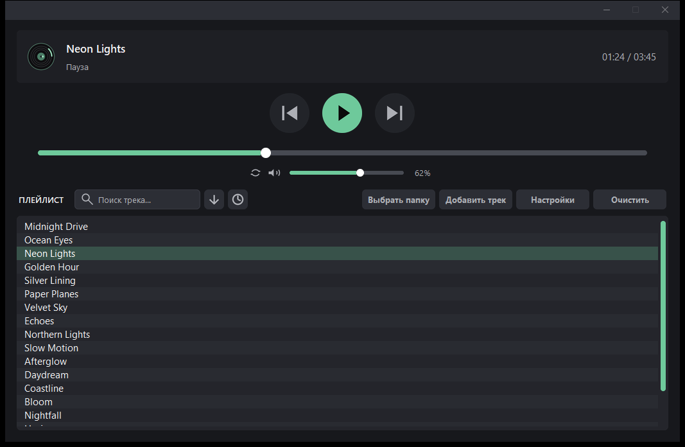
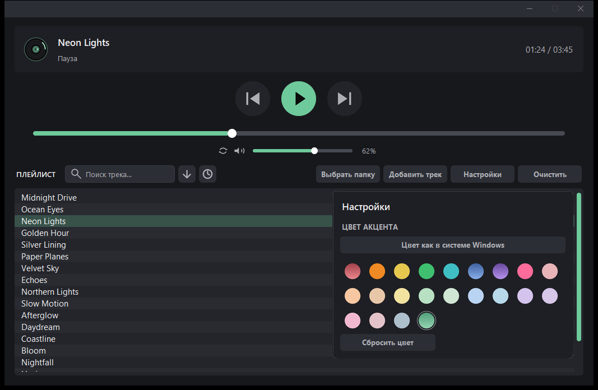

# ZhumWave (Open Source)

ZhumWave — минималистичный тёмный музыкальный плеер для Windows (MP3-аудио треки). Акцент Windows или ручная палитра, сохранение громкости
и состояния Mute, восстановление плейлиста и обозначение недоступных файлов.

Программу я полностью делал в ИИ, не судите строго(

## Скачать

Готовые файлы находятся в разделе **Releases** этого репозитория:

- `ZhumWave-Setup-1.0.0.exe` — установщик;
- `ZhumWave-1.0.0-portable.zip` — портативная версия;
- `SHA256SUMS.txt` — контрольные суммы.

Установщик не требует прав администратора, создаёт ярлыки и при желании
включает автозапуск при входе в Windows.

## Возможности

- MP3, перемотка ±10 секунд, повтор трека.
- Два независимых списка: папка и добавленные треки.
- Приблизительный поиск по буквам, опечаткам и вставка из буфера обмена.
- История прослушиваний текущего сеанса.
- Тёмная тема, акцент Windows или ручная палитра, включая градиенты.
- Сохранение плейлиста, громкости, Mute, повтора и последней позиции.
- Установщик с ярлыками, деинсталлятором и автозапуском.





## Установка

Для обычной установки запустите `ZhumWave-Setup-1.0.0.exe`. Установщик
работает без прав администратора и ставит программу в
`%LOCALAPPDATA%\Programs\ZhumWave`, создаёт ярлыки в меню «Пуск» и на рабочем
столе, добавляет запись в «Параметры → Приложения» и штатный деинсталлятор.

Во время установки можно включить автозапуск: при входе в Windows ZhumWave
запустится свёрнутым в панель задач, загрузит сохранённый плейлист и последнюю
позицию. Воспроизведение автоматически не начинается.

Портативная версия — `ZhumWave-1.0.0-portable.zip`: распакуйте и запустите
`ZhumWave.exe`.

## Запуск

Двойной клик по `ZhumWave.exe`.

При запуске сразу открывается окно плеера (1051 × 657). Проводник и диалог
выбора папки автоматически **не** открываются: ранее импортированный список
треков восстанавливается автоматически. Папка и отдельные треки добавляются
только по нажатию кнопок `Выбрать папку` / `Добавить трек`.

## Сборка .exe

Двойной клик по `build_exe.bat`:

1. ставит зависимости;
2. генерирует `ZhumWave.ico` из `ZhumWave.png` (скрипт `make_icon.py`);
3. собирает `dist\ZhumWave.exe` через `ZhumWave.spec` (one-file, с иконкой
   и метаданными `version_info.txt`).

EXE не требует установленного Python.

## Кнопки

| Кнопка | Что делает |
|---|---|
| `Выбрать папку` | импортирует папку: в пустое окно сразу, при готовом списке — в новое независимое окно |
| `Добавить трек` | стандартный диалог выбора; выбранные файлы добавляются в текущий список |
| `Настройки` | панель акцента: цвет Windows, ручная палитра, сброс |
| `Очистить` | очистить текущий список |
| ⏮ ▶/⏸ ⏭ | предыдущий, играть/пауза, следующий |
| `Повтор` (иконка) | повторять текущий трек бесконечно |
| стрелка рядом с поиском | плавно прокрутить список в конец (стрелка вниз) или в начало (стрелка вверх) |
| часы рядом со стрелкой | открыть встроенную историю прослушиваний за текущий сеанс |

## Тема и цвет акцента

У ZhumWave одна постоянная **тёмная тема** со светло-чёрным графитовым фоном;
светлая тема Windows не используется. Настройки открываются внутри окна
отдельной панелью со скруглёнными углами, рамкой и той же типографикой, что и
остальной интерфейс.

- `Цвет как в системе Windows` — акцент берётся из оформления Windows и
  обновляется автоматически при его изменении (фон остаётся тёмным).
- Ручная пастельная палитра — акцент фиксируется до следующего выбора;
  выбранный кружок обведён тонким серым кольцом.
- `Красный градиент`, `Синий градиент`, `Фиолетовый градиент` и
  `Зелёный градиент` — спокойные акценты; в палитре они показаны градиентом,
  а интерфейс использует средний тон, поэтому дополнительной нагрузки на
  отрисовку нет.
- `Сбросить цвет` возвращает серебристый стандартный акцент.
- Выбранный режим сохраняется и восстанавливается при запуске.
- Панель закрывается повторным нажатием `Настройки`, кликом вне панели или
  клавишей `Esc`; крестика и подписи с HEX-кодом нет.

## Громкость и Mute

- При первом запуске без сохранённых настроек громкость — **20%**.
- Ползунок громкости: заливка акцентная, белая точка-бегунок; края дорожки
  скруглённые, цвет заливки совпадает с акцентом интерфейса.
- Колесо мыши над ползунком громкости (или иконкой/процентом) меняет громкость
  шагами по 2% в диапазоне 0–100%.
- Клик по иконке динамика слева от ползунка включает/выключает **Mute**.
  При Mute показывается перечёркнутый динамик, ползунок остаётся на прежнем
  уровне, звук движка приравнивается к нулю. Повторный клик возвращает
  сохранённую громкость.
- Состояние Mute и уровень громкости сохраняются отдельно и восстанавливаются
  при запуске. Переключение треков не сбрасывает и не включает звук.

## Продолжение воспроизведения

При закрытии ZhumWave запоминает текущий трек и позицию в секундах. При
следующем запуске трек и таймкод восстанавливаются, но воспроизведение
**не начинается само** — нужно нажать `▶`. Если файл к этому времени удалён,
запуск не происходит, а плеер сообщает, что прошлый трек недоступен.

## «Открыть с помощью»

ZhumWave регистрируется в Windows (HKCU, без прав администратора) как
программа для открытия **только `.mp3`**. Файл можно открыть из Проводника
через «Открыть с помощью» → ZhumWave; видеофайлы (включая `.mp4`) через эту
интеграцию не открываются — показывается уведомление. Внутри плеера MP3/MP4
по-прежнему поддерживаются.

ZhumWave работает в одном экземпляре. Файлы из Проводника передаются уже
запущенному окну; новое окно и второй экземпляр не создаются. Если основной
плейлист загружен из папки, выбранные файлы добавляются в него и сохраняются
вместе с ним. Если папка ещё не загружена, создаётся временный список
добавленных треков в текущем окне. Несколько файлов добавляются по порядку и
воспроизводятся последовательно. Регистрация не вызывает обновления рабочего
стола и не перезапускает Проводник.

## Перетаскивание файлов

Аудиофайлы MP3/MP4 можно перетащить из Проводника прямо в окно ZhumWave.
Поддерживается несколько файлов одновременно, порядок сохраняется. Дальше
действует то же правило: при загруженной папке треки добавляются в основной
плейлист, без папки — во временный список текущего окна. Дополнительные окна
не открываются.

## Поиск

Поле с лупой справа от надписи `ПЛЕЙЛИСТ` (подсказка «Поиск трека…»)
ищет по ключевым словам (можно несколько слов) и показывает в основном
плейлисте похожие треки. Двойной клик по найденному треку возвращает полный
список, прокручивает к его исходному месту и запускает его. `Enter` играет
выделенный/первый найденный трек, не сбрасывая поиск.

Поиск приблизительный, «по буквам»: сначала находится точная подстрока, затем
буквы запроса по порядку (даже если между ними есть другие символы), затем
небольшие опечатки. Все слова запроса должны найтись хотя бы одним из этих
способов. Порядок треков в плейлисте при поиске не меняется.

Текст можно вставить из буфера обмена: `Ctrl+V`, `Shift+Insert` или правым
кликом по полю поиска → `Вставить`. Меню также позволяет скопировать
выделенное, выделить всё и очистить поле. Многострочный текст автоматически
превращается в одну строку, после вставки список фильтруется сразу.

Поиск остаётся активным при перемотке, паузе, продолжении воспроизведения и
переключении треков: запрос, найденные треки, выделение и положение прокрутки
не меняются. Плейлист не перестраивается при обновлении таймера и
прогресс-бара. Сбрасывается поиск только явно — по `Esc` или очисткой поля.
Клик по кнопкам, плейлисту, прогресс-бару и другим областям убирает фокус из
поля ввода (буквы больше не попадают в поиск), но запрос сохраняется.
Фокус ставится в поиск только при клике по самому полю или по лупе.

Крестик очистки появляется только при введённом запросе и полностью скрыт в
пустом поле. Место под него зарезервировано, поэтому поле не меняет размер и
положение. Клик по крестику очищает запрос и возвращает обычный плейлист, не
меняя текущий трек и состояние воспроизведения.

## Плейлист

- в названиях треков **нет расширений** `.mp3`  (файлы на диске и пути
  не меняются, поиск и сортировка работают по имени без расширения);
- сверху идут треки из папки с сохранённой нумерацией и порядком;
- ниже, после тонкой горизонтальной полосы, — добавленные файлы: без
  нумерации, в порядке добавления; группы не смешиваются;
- поиск, перемотка и переключение треков не меняют это разделение; полоса
  остаётся, пока видны обе группы; при добавлении список не перестраивается;
- полоса прокрутки находится строго внутри области плейлиста, с отступом
  8 px сверху и 8 px снизу; ширина и стиль прежние;
- верхняя панель и область плейлиста имеют скруглённые углы, как у кнопок;
- выбранный трек подсвечивается на всю ширину — от левого края плейлиста;
- линия скроллбара сдвинута чуть правее, стоит по центру жёлоба и окрашена
  в цвет акцента интерфейса;
- окно показывается уже полностью отрисованным — без мигания и артефактов;
- контейнер списка без внешней рамки;
- чётные и нечётные строки различаются фоном, есть hover/pressed;
- активный трек выделен мягким серебристым фоном;
- **недоступные файлы** выделяются красно-белым фоном (красная строка,
  белый текст), остаются на своих местах и не удаляются автоматически. Если
  файл вернётся, выделение снимается при следующей проверке;
- при попытке воспроизвести недоступный файл показывается уведомление;
- длинные имена обрезаются многоточием; полоса прокрутки не перекрывает текст.

## Несколько окон

Если в текущем окне уже есть треки, кнопка `Выбрать папку` открывает папку в
**новом независимом окне**. Если список пуст, папка импортируется в это же
окно. У каждого окна свой плейлист, текущий трек, история, громкость, Mute,
повтор и позиция. Окна можно запускать, останавливать и
перематывать отдельно. Закрытие одного окна не останавливает и не закрывает
остальные. После закрытия последнего окна процесс завершается.

## История прослушиваний

Кнопка-часы рядом со стрелкой прокрутки открывает встроенную панель истории.
Она показывает только текущий сеанс:

- записи оформлены компактными карточками с мягким скруглением;
- панель появляется с короткой плавной анимацией;
- рисуются только видимые строки: история с сотнями или тысячами записей
  открывается быстро и не замедляет плеер;
- новые записи появляются сверху;
- справа от названия нет счётчика запусков — показывается только трек;
- повторный запуск не перемещает запись: она остаётся на своём месте;
- пауза, продолжение и перемотка порядок не меняют;
- одинаковые треки не дублируются;
- названия показываются без расширений;
- при большом количестве записей работает прокрутка колесом и полосой;
- двойной клик по записи сразу запускает трек, не перемещая пользователя по
  основному плейлисту и не меняя его порядок; треки из нижней секции тоже
  воспроизводятся;
- после запуска из истории её порядок остаётся прежним;
- панель закрывается повторным нажатием на часы или кликом в любом месте вне
  панели; крестика и лишней подписи нет;
- закрытие не останавливает музыку и не очищает историю;
- история полностью очищается после закрытия ZhumWave и не записывается
  в настройки.

## Верхняя панель и копирование названия

В верхней панели показывается только название текущего трека и состояние
воспроизведения — без порядкового номера. В плейлисте нумерация сохраняется и
соответствует порядку треков.

Клик по названию копирует его в буфер обмена Windows: без расширения и без
номера. Воспроизведение и позиция не меняются; в строке состояния на
несколько секунд появляется «Название скопировано».

Рядом с названием находится виниловая пластинка. Во время воспроизведения она
плавно вращается (движется блик и метка на пластинке); на паузе вращение
замирает, при продолжении возобновляется с того же места. При остановке или
без трека пластинка становится приглушённой. При переключении треков вращение
не прерывается. Анимация обновляет только блик и метку, без перерисовки диска.

## Клавиатура

| Клавиши | Действие |
|---|---|
| `←` или `A` | назад на 10 секунд |
| `→` или `D` | вперёд на 10 секунд |
| `↑` или `W` | выделить предыдущий трек |
| `↓` или `S` | выделить следующий трек |
| `Enter` / двойной клик | играть выбранный трек |
| `Пробел` | играть / пауза (кроме поля поиска) |

Работает и в русской раскладке (`Ф` / `В`, `Ц` / `Ы`).

## Где хранятся настройки и плейлист

Все данные — в постоянной папке пользователя:

```
%APPDATA%\ZhumWave\player_settings.json
```

В файле хранятся: акцентный цвет и режим акцента (`manual` или `system`; тема
всегда тёмная, «Сбросить цвет» возвращает серебристый), громкость, состояние
Mute, повтор, список треков
отдельно двумя группами (из папки и добавленные), папка, а также последний
трек и таймкод для продолжения. Акцентный цвет
записывается сразу после выбора; запись атомарная (временный файл + замена),
поэтому цвет не теряется даже при аварийном завершении через Диспетчер задач.
Настройки не теряются при пересборке EXE и обновлении. При первом запуске
старый `player_settings.json` из папки проекта автоматически переносится.
Если папка с основным плейлистом загружена, добавленные через Проводник,
перетаскивание или `Добавить трек` файлы сохраняются вместе с ним. Временный список,
созданный без папки, в файл настроек не записывается.

## Особенности

- интерфейс DPI-aware: на масштабировании Windows 125/150 % ничего не мылится;
- иконки и ползунки рисуются векторно с 8-кратным сглаживанием;
- иконка Play/Pause и подпись состояния синхронизированы с движком;
- бегунок перемотки не обрезается по краям и увеличивается при наведении;
- дорожки перемотки и громкости имеют скруглённые края;
- на паузе/остановке перемотка не включает звук; при играющем треке
  используется быстрый seek без повторной загрузки файла;
- аудиодорожка обновляется до 30 раз в секунду по позиции аудиопотока:
  движение плавное, без рывков, на паузе останавливается; подпись времени
  обновляется только при смене секунды;
- виниловая пластинка вращается по реальному времени, независимо от таймера
  воспроизведения; при перемотке назад крутится назад, при перемотке вперёд —
  быстрее, после отпускания плавно возвращается к обычному вращению;
  на паузе при перемотке пластинка также крутится в нужную сторону;
  перемотка не сбрасывает угол;
- пластинка рисуется в высоком разрешении и поворачивается как изображение:
  края, дорожки, блик и метка остаются гладкими, без пиксельных артефактов;
- поиск применяется с короткой задержкой ввода, кэширует нормализованные
  названия и не перестраивает список при обновлении таймера; проверка
  доступности файлов не сканирует весь плейлист при каждом переключении трека;
- в истории рисуются только видимые карточки, поэтому тысячи записей не
  создают тысячи элементов интерфейса;
- верхняя панель с пластинкой, названием, статусом и временем имеет
  скруглённые углы без внешней обводки;
- при запуске окно показывается уже полностью отрисованным, без мигания;
  полные фоновые изображения панелей не создаются, а регистрация
  «Открыть с помощью» повторно не перезаписывается на каждом запуске;
- тяжёлые аудиомодули (`numpy`, `sounddevice`, `ffmpeg`) подключаются при
  первом воспроизведении, поэтому окно появляется быстрее;
- неиспользуемый аудиомодуль pygame больше не загружается — запуск быстрее,
  а размер EXE меньше;
- все кнопки панели рядом с поиском имеют одинаковые ширину и высоту,
  одинаковые промежутки; иконки центрированы внутри кнопок;
- длительность часовых треков определяется в фоне, поэтому запуск и
  интерфейс не зависают;
- системный заголовок Windows окрашивается в тон кнопок (светло-чёрный
  графит); в шапке нет видимой иконки, текст заголовка скрыт цветом, кнопки
  сворачивания и закрытия остаются стандартными;
- в панели задач и Alt+Tab видно, что играет: `ZhumWave — название трека`
  (когда трек не выбран — просто `ZhumWave`);
- иконка приложения — новое зелёное кольцо с кнопкой Play (`ZhumWave.png`,
  в EXE — встроенный `ZhumWave.ico`); она видна в Проводнике, на панели задач
  и в Alt+Tab;
- окно строго фиксировано: 1051 × 657, без растягивания и максимизации;
  кнопки сворачивания и закрытия работают как обычно;
- при сворачивании обновление отрисовки приостанавливается, при восстановлении
  выполняется лёгкая перерисовка без чёрных кадров и мерцания;
- пауза срабатывает почти мгновенно: короткий плавный fade-out без щелчков,
  закрытие потока выполняется после затухания;
- кнопка-иконка повтора слева от динамика зацикливает текущий трек;
  состояние сохраняется;
- стрелки и W/S двигают выделение в плейлисте, не переключая воспроизведение;
- текстовые кнопки панели имеют единый размер, равные промежутки, скругление
  и жирный центрированный текст; кнопки-иконки стрелки и истории — квадратные
  того же стиля и высоты; поле поиска сохраняет прежний обычный шрифт;
- звук идёт через потоковый ffmpeg/PortAudio: часовые треки не загружаются
  в память целиком;
- каждое окно имеет собственный плейлист, историю, громкость, Mute, повтор и
  воспроизведение; окна не останавливают и не закрывают друг друга.
